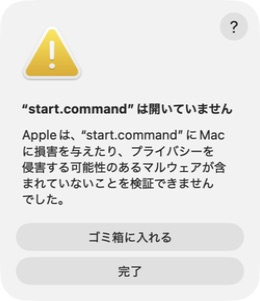
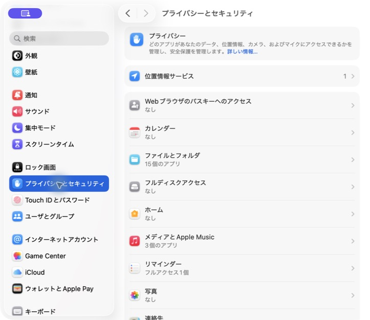
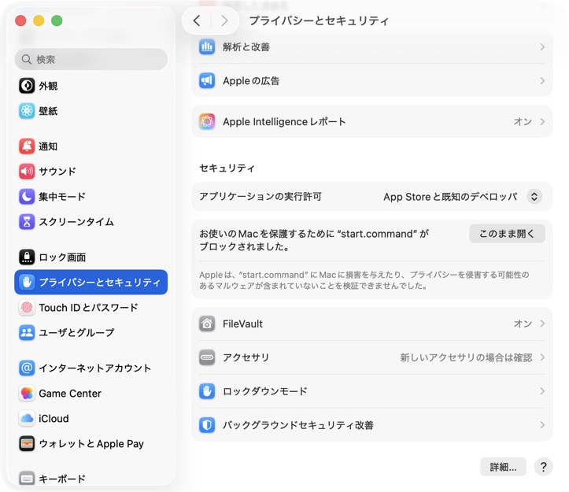
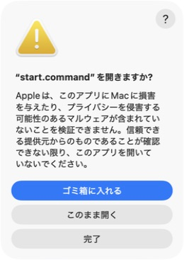

# 御厨こども食堂の謎

## ⚠️注意⚠️
> **⚠️ 無断で他者のシステムへ侵入する行為は犯罪です。**

> 本作のハッキング演習は、同梱されたローカルのCTF環境だけを対象にしてください。ゲーム内で学んだ手法を、許可のないWebサイトやサーバーに対して実行しないでください。

## 概要

表の顔は子ども食堂を経営する寿司屋。しかし、その周りで囁かれる子供の失踪事件……果たして、その真実とは……？

『御厨こども食堂の謎』は怪しい寿司屋のWebサイトをハッキングし、集めた証拠から失踪事件の真相を探る、日本語の事件調査CTF※です。
※セキュリティの知識や技術を使って課題を解く競技のこと

プレイヤーは探偵事務所のアルバイトとして、こども食堂に通っていた少女の行方を調べます。Webページ、共有フォルダーの資料、メールなどを読み比べ、判明した人物名や事実を「調査ノート」の空欄に記入すると、物語が進みます。技術を使って証拠を見つけることと、その内容から事件を推理すること、そしてその先に眠る真実に辿り着くことがゲームの目的です。

- **実際のツールで調査する**：ブラウザからKali Linuxの調査端末を操作し、ターミナルにコマンドを入力します。使用するのはどれも実際にハッキングに使用されるツールです。
- **操作を学びながら進める**：序盤は案内に沿って基本操作から学べます。行き詰まったときには段階的なヒントを参照でき、後半はそれまでに学んだ手法を組み合わせて調査します。
- **調査環境をまとめて起動する**：調査ノート、ツール入りの調査端末、攻略対象はローカルのDocker環境で動作します。初回の準備後はオフラインで攻略でき、進捗を保存して中断・再開できます。

## 必要な環境

- 動作確認済み: Apple Silicon搭載Mac（M1以降）
- 動作未確認: Windows 11 / Linux
- メモリ8GB以上、空き容量4GB以上が目安
- Docker Desktop / Docker
- インターネット接続（初回のみ）

## はじめかた

1. [Windows用](https://docs.docker.com/desktop/setup/install/windows-install/) または [Mac用](https://docs.docker.com/desktop/setup/install/mac-install/) のDocker Desktopをインストールして起動します。Macは「Apple silicon」を選び、WindowsでWSL 2の導入や再起動を求められたら案内に従ってください。
2. [Windows用ZIP](https://github.com/FakeDocument/MysteryOfMikuriyaKodomoShokudo/releases/latest/download/MysteryOfMikuriyaKodomoShokudo-Windows-x64.zip) または [Mac用ZIP](https://github.com/FakeDocument/MysteryOfMikuriyaKodomoShokudo/releases/latest/download/MysteryOfMikuriyaKodomoShokudo-macOS-arm64.zip) をダウンロードして展開します。
3. 展開したフォルダーの `start.bat`（Windows）または `start.command`（Mac）をダブルクリックします。
4. ブラウザに調査ノートが開いたら、序章から読み進めてください。

初回の準備には数分以上かかることがあります。「準備ができました」と表示されるまでウィンドウを閉じないでください。

### Macで「Appleは検証できませんでした」と表示されたら

Macで `start.command` を初めて開くと、Appleがファイルを検証できないという警告が表示されることがあります。マルウェアが検出されたという意味ではありません。GitHub Releasesからダウンロードしたファイルであることを確認して、次の手順で許可してください。

1. 警告画面の「完了」を選びます。

    

2. 「システム設定」→「プライバシーとセキュリティ」を開きます。

    

3. 右側を下へスクロールし、「セキュリティ」欄の `start.command` にある「このまま開く」を選びます。

    

4. 確認画面でも「このまま開く」を選びます。MacのパスワードやTouch IDによる認証を求められた場合は、画面の案内に従ってください。

    

「このまま開く」が見つからない場合は、`start.command` をもう一度開いて警告を閉じてから設定を確認してください。`stop.command` や `reset.command` に同じ警告が出た場合も、ファイルごとに同じ手順で許可してください。[Apple公式の案内](https://support.apple.com/ja-jp/102445)も参照できます。

## 中断・再開

- 中断：`stop` を実行します。進行状況は残ります。
- 再開：Docker Desktopを起動して `start` を実行します。
- 最初から：`reset` を実行し、確認で `y` を入力します。進捗はすべて削除されます。

ブラウザを閉じるだけでは停止しません。

## 起動できないとき

Docker Desktopの起動を確認し、もう一度 `start` を実行してください。ブラウザだけが開かない場合は、[調査ノート](http://127.0.0.1:8080/)を開いてください。

[詳しいトラブル対処](https://github.com/FakeDocument/MysteryOfMikuriyaKodomoShokudo/blob/main/docs/troubleshooting.md)
